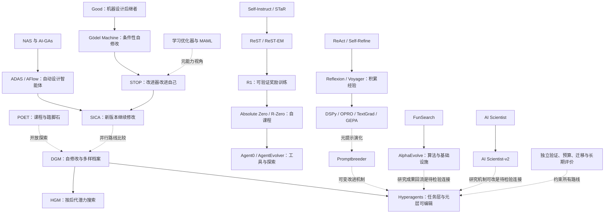

# 02｜把论文串起来：问题如何演化

[返回总览](README.md) · [完整编号索引](13_bibliography.md)

本章的箭头首先表示“理解下一问题所需的连接”，不自动代表文献直接引用。只有下表明确标为“直接扩展”的关系，才主张原论文明确建立了后续关系。其余是本笔记的比较或综合。

## 1. 主线不是一条，而是四条路线汇合

此图刻意不把所有 64 个节点挤进一张图。每篇都有唯一卡片和双向可追踪的阅读连接；下文八条链覆盖所有编号。

## 2. 八条完整阅读链

### 链 A：从“能否自改”到“怎样学习改进过程”

[P01 Good](03_foundations.md#p01) 提出机器设计更好机器的可能；[P02 Gödel Machine](03_foundations.md#p02) 给出形式化但很难计算的改写条件。[P03 学习优化器](03_foundations.md#p03) 学更新规则，[P04 MAML](03_foundations.md#p04) 学适合更新的初始化，[P05 NAS](03_foundations.md#p05) 学结构设计。三者分别展示可优化对象的扩展，不能当作同一个 RSI 算法。

[P06 AlphaZero](03_foundations.md#p06) 展示环境反馈支持强自博弈；[P07 POET](03_foundations.md#p07) 让环境本身也变化；[P57 AI-GAs](03_foundations.md#p57) 将架构、学习算法和学习环境统一为研究议程。它们为现代 RSI 提供不同零件，而非已经组装好的终点。

### 链 B：从缺数据到缺可靠评价

[P08 Self-Instruct](04_self_training.md#p08) 生成任务数据，[P09 STaR](04_self_training.md#p09) 生成并筛选推理；[P10 ReST](04_self_training.md#p10) 与 [P11 ReST-EM](04_self_training.md#p11) 把生成—筛选—更新系统化。[P14 Quiet-STaR](04_self_training.md#p14) 把中间思考训练扩到普通文本，[P39 Toolformer](04_self_training.md#p39) 则学习工具调用。

另一支由 [P16 Constitutional AI](04_self_training.md#p16) 的 AI 反馈与 [P15 DPO](04_self_training.md#p15) 的偏好优化汇合：[P12 SPIN](04_self_training.md#p12) 用历史模型回答对照人类示范，[P13 Self-Rewarding](04_self_training.md#p13) 让模型自产偏好，[P60 Self-Taught Evaluators](04_self_training.md#p60) 把评价器本身作为训练对象。主矛盾由“数据不够”转为“自生成的监督为何可信”。

### 链 C：从固定题库到共同演化的课程

[P17 R1](05_curricula.md#p17) 展示可验证奖励训练的重要性；[P18 Absolute Zero](05_curricula.md#p18) 把出题纳入执行反馈循环，[P19 R-Zero](05_curricula.md#p19) 使用挑战者—求解者及多数票伪标签。它们是并行方案，不应把出现时间画成严格依赖链。

[P20 Agent0](05_curricula.md#p20) 将工具能力带入共同演化；[P56 AgentGym](05_curricula.md#p56) 从多环境轨迹学习切入；[P55 AgentEvolver](05_curricula.md#p55) 同时优化造题、导航和归因。所有方法最终都要证明课程对未见任务有效，而非内部难度指标越来越高。

### 链 D：从当前答案修正到可复用的系统改进

[P21 ReAct](06_scaffolds.md#p21) 获取环境观察；[P22 Self-Refine](06_scaffolds.md#p22) 修订当前输出；[P23 Reflexion](06_scaffolds.md#p23) 保存语言经验；[P24 Voyager](06_scaffolds.md#p24) 保存可执行技能。变化的核心是能力保留的载体。

[P25 DSPy](06_scaffolds.md#p25) 提供可优化程序表示，[P26 OPRO](06_scaffolds.md#p26) 用历史得分引导提案，[P27 TextGrad](06_scaffolds.md#p27) 传播语言反馈，[P28 GEPA](06_scaffolds.md#p28) 从轨迹与互补候选中学习。与这些主要优化任务层的方法相比，[P59 Promptbreeder](06_scaffolds.md#p59) 同时演化变异提示，触及元机制。

### 链 E：从自动设计到改进器进入自身搜索空间

[P29 STOP](07_recursive_agents.md#p29) 让程序改进器改自己；[P30 ADAS](07_recursive_agents.md#p30) 用固定元智能体设计任务智能体；[P38 AFlow](07_recursive_agents.md#p38) 用树搜索探索工作流。[P31 Gödel Agent](07_recursive_agents.md#p31) 引入自身逻辑修改；[P40 SWE-agent](07_recursive_agents.md#p40) 说明工具接口为何值得优化。

[P32 SICA](07_recursive_agents.md#p32) 从历史优秀版本继续自改；[P33 DGM](07_recursive_agents.md#p33) 保留多样版本探索；[P61 HGM](07_recursive_agents.md#p61) 提醒当前得分不等于后代潜力；[P51 Hyperagents](10_frontier.md#p51) 更明确地同时开放任务和元程序。这一链最适合直接作为 agent-RSI 的 related work 主体。

### 链 F：从可验证程序发现到研究流程自动化

[P34 FunSearch](08_automated_science.md#p34) 与 [P35 AlphaEvolve](08_automated_science.md#p35) 以可执行算法作为产物；[P36 AI Scientist](08_automated_science.md#p36) 与 [P37 AI Scientist-v2](08_automated_science.md#p37) 以完整研究过程作为对象。两支都需要证明成果有效；再将成果用于提升下一轮研究，是接近 RSI 的额外一步。

### 链 G：用反面证据约束自改进主张

[P41 自纠错局限](09_evaluation.md#p41) 与 [P42 SCoRe](09_evaluation.md#p42) 区分未经训练的修订和学得的纠错；[P43 过程监督](09_evaluation.md#p43) 与 [P44 模型裁判](09_evaluation.md#p44) 区分步骤反馈与开放偏好。[P45 SWE-bench](09_evaluation.md#p45)、[P46 AgentBench](09_evaluation.md#p46)、[P47 RE-Bench](09_evaluation.md#p47) 分别评价软件修复、环境交互和研究工程。

[P48 奖励过优化](09_evaluation.md#p48) 检查代理目标，[P49 模型坍塌](09_evaluation.md#p49) 与 [P50 数据累积](09_evaluation.md#p50) 检查递归数据条件。它们共同要求独立、预算匹配且能测退化的实验。

### 链 H：把前沿声明转为可测问题

[P52 GAI](10_frontier.md#p52) 提供系统边界视角；[P53 基准污染](10_frontier.md#p53) 研究错误信号的持久化；[P62 AgentStream](10_frontier.md#p62) 检查任务流，[P63 修复与泛化差距](10_frontier.md#p63) 检查经验迁移，[P64 进步错觉](10_frontier.md#p64) 检查自评与外部结果分离。[P54](10_frontier.md#p54) 和 [P58](10_frontier.md#p58) 两篇综述分别帮助扩展闭环/评价视角与模型/支架视角。

## 3. 关键边的性质

| 连接 | 关系类型 | 应该怎样表述 |
|---|---|---|
| STaR → Quiet-STaR | 直接扩展 | 从有答案的问答推理扩到一般文本中的潜在思考 |
| AI Scientist → v2 | 直接扩展 | 减少模板依赖并引入研究树搜索 |
| DGM → Hyperagents | 直接扩展 | 把任务程序和元程序显式纳入可编辑系统 |
| DGM/SICA ↔ HGM | 问题接续与比较 | 父代当前表现不一定反映后代潜力 |
| NAS ↔ ADAS | 方法类比 | 自动设计思想由模型结构扩到智能体程序 |
| POET ↔ DGM | 概念/机制联系 | 多样路径与踏脚石；不是相同算法的改名 |
| Self-Refine ↔ Cannot Self-Correct | 条件对照 | 反馈、任务、模型和评估协议不同 |
| Model Collapse ↔ Data Accumulation | 假设对照 | 替换数据与保留累积数据不产生同一结论 |
| AZR ↔ R-Zero | 反馈对照 | 执行验证与多数票伪标签不等价 |
| AlphaEvolve ↔ DGM | 对象对照 | 优化目标算法与优化自身智能体需区分 |

所有连接的原文入口在对应论文卡片。图和表属于本笔记的综合组织；不表示已通过自动引文分析验证完整引用网络。

## 4. 怎样用这张图组织自己的论文

先说明改进对象，再说明反馈来源，然后比较改进机制是否变化，最后指出尚未测清楚的性质。例如：“已有代码 RSI 能演化工具和元程序，但在等总成本、跨任务流变化下，父代潜力估计的可靠性仍需针对性验证。”这比“现有方法都不能自我改进”更准确，也更容易设计实验。
