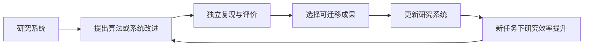

# 08｜程序发现与自动科研

[返回总览](README.md) · 本章收录 P34–P37。

自动科研与 RSI 有交集，但并非同义。一个系统可以自动发现算法，却不改进自身；也可以优化自己，却没有产生新的科学知识。连接这两者的关键，是研究成果是否被可靠验证并进入下一轮研究系统。

## P34｜Mathematical discoveries from program search with large language models（FunSearch）

**文献**：Bernardino Romera-Paredes 等，2023 在线发表，Nature 625（2024）。[期刊原文](https://www.nature.com/articles/s41586-023-06924-6)。

**问题与方法**：语言模型容易提出看似合理但错误的想法。FunSearch 将冻结模型与系统化评价器结合，让模型生成程序候选，执行评分后保留不同程序种群；在给定程序骨架中搜索关键函数。

**证据**：论文报告 cap set 构造和在线装箱启发式上的新结果。输出程序而非仅输出答案，使构造可以执行、放大并被研究者检查。

**边界**：问题形式、骨架和评价器由研究者提供；效果依赖可计算且有信息量的目标。系统优化的是目标程序，并非默认优化 FunSearch 自己。

**连接**：与 [P07 POET](03_foundations.md#p07) 联系多样性和踏脚石，与 [P29 STOP](07_recursive_agents.md#p29) 区分“改目标程序”和“改程序改进器”；[P35](#p35) 把程序进化扩展到更广的算法工程场景。

**研究启发**：选择可生成可验证的新算法任务，先研究评价器如何引导探索，而不是从没有可靠评价标准的开放科研开始。

## P35｜AlphaEvolve: A coding agent for scientific and algorithmic discovery

**文献**：Alexander Novikov 等，2025 白皮书；近期代表作。[论文](https://arxiv.org/abs/2506.13131) · [团队介绍](https://deepmind.google/blog/alphaevolve-a-gemini-powered-coding-agent-for-designing-advanced-algorithms/)。

**问题与方法**：组织多个语言模型提出代码改动，通过一个或多个自动评价器检验，利用进化式程序档案继续改进算法。与局部函数搜索相比，它面向更复杂的代码和多种科学/工程目标。

**证据**：团队报告数学算法与计算基础设施优化案例，包括与 AI 训练相关的基础设施。对具体收益的引用必须回到各自目标、约束与基线，不应合并成单一“智能提升率”。

**边界**：基础设施效率提升可能有利于后续模型训练，但不等于系统已独立训练、部署并验证更强后继模型。自动发现局部优化与闭合整个 AI 研究循环仍有距离。

**连接**：沿 [P34 FunSearch](#p34) 的“生成程序—执行评价—进化选择”主线；与 [P33 DGM](07_recursive_agents.md#p33) 对照目标程序是否就是智能体自身；与 [P47 RE-Bench](09_evaluation.md#p47) 连接 AI 研发工程评测。

**研究启发**：把自改进收益分为能力提升与效率提升；在固定总算力下检验效率改进是否真正转化为下一轮更好的搜索。

## P36｜The AI Scientist: Towards Fully Automated Open-Ended Scientific Discovery

**文献**：Chris Lu、Cong Lu、Robert Tjarko Lange、Jakob Foerster、Jeff Clune、David Ha，2024。[原文](https://arxiv.org/abs/2408.06292)。

**问题与方法**：把创意提出、实验代码、运行、分析、作图、论文写作和模拟评审连接成研究流程。初版以给定研究方向和代码模板作为起点，演示多个机器学习子领域。

**证据**：展示端到端研究产物生成的可行性。论文中的自动审稿分数是评价工具的判断，不能当作真实顶会接受记录，也不能自动证明结论可靠或创新成立。

**边界**：模板、实验资源、文献检索和评价质量影响产物；生成完整论文不等于完成独立复现。系统没有因每篇产物生成就必然升级自己的研究机制。

**连接**：[P01 Good](03_foundations.md#p01) 的“AI 参与设计更好的 AI”在此有流程层实例；[P37](#p37) 减少模板依赖；[P44](09_evaluation.md#p44)、[P47](09_evaluation.md#p47) 分别补充裁判与研究工程评价。

**研究启发**：用独立执行后的实验有效性、相对强基线的增益及失败报告完整性评价研究产物，而非只计论文数量或自动评分。

## P37｜The AI Scientist-v2: Workshop-Level Automated Scientific Discovery via Agentic Tree Search

**文献**：Yutaro Yamada 等，2025；近期代表作。[原文](https://arxiv.org/abs/2504.08066)。

**问题与方法**：初版受人工代码模板约束。v2 使用实验管理智能体与逐步展开的树搜索组织研究分支，并利用视觉语言反馈改进图表与呈现。

**证据**：作者报告向 ICLR workshop 提交三篇自主生成稿件，其中一篇达到接受标准。这是有边界的外部评审案例，不能表述为主会录用率或普遍达到人类科学家水平。

**边界**：有限提交样本、审稿噪声与研究方向限制仍在；外部接受并不替代正确性复查、复现与长期科学影响判断。

**连接**：是 [P36](#p36) 的直接后续；与 [P38 AFlow](07_recursive_agents.md#p38) 连接树搜索组织复杂流程的思想；若要进一步走向 [P51](10_frontier.md#p51) 式元改进，还需让研究管理机制的变化产生可复用收益。

**研究启发**：让研究智能体自动提出改进自身实验流程的候选，并在密封的新研究任务上测试。这比单纯增加生成论文数量更接近 RSI。

## 从自动研究到递归研究，缺哪几条边？

这是一张研究目标图，不代表上述论文已经完成全部环节。尤其需要验证最后两条边：产物被采用后，后续研究是否真的更有效，以及收益能否跨研究任务复用。
